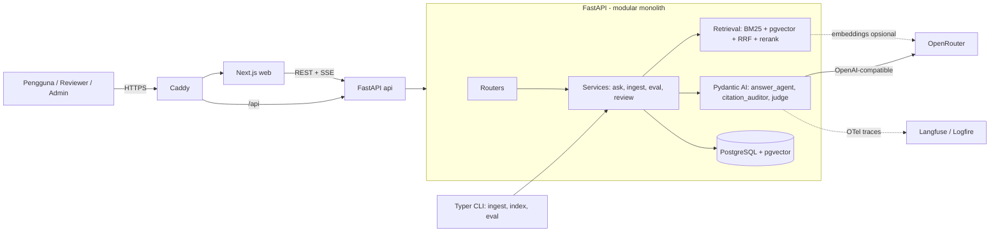

# PRD — K2-RAG: Asisten Tanya Jawab SOP & Standar Keselamatan Ketenagalistrikan

**Versi:** 1.1 · **Tanggal:** 12 November 2026 · **Pemilik:** Kelompok 4, Kecerdasan Artifisial — Magister Teknik Elektro
**Status:** Disetujui untuk dibangun (Minggu 2–4 proyek)
**Perubahan v1.1:** agen memakai Pydantic AI; database PostgreSQL + pgvector (menggantikan SQLite + FAISS); evaluasi generasi memakai Pydantic Evals; observabilitas via OpenTelemetry (Langfuse/Logfire); frontend dirinci (TanStack Query, viewer PDF, auth berbasis peran); arsitektur dan ADR ditambahkan.

---

## 1. Ringkasan

K2-RAG adalah aplikasi web yang menjawab pertanyaan teknis tentang regulasi dan SOP keselamatan ketenagalistrikan berbahasa Indonesia. Setiap jawaban **wajib menyertakan kutipan sumber tingkat pasal/ayat** yang bisa diklik untuk melihat teks aslinya dan halaman PDF-nya. Sistem menolak menjawab (abstain) bila bukti di korpus tidak cukup.

Aplikasi ini juga **alat riset**: ia membandingkan beberapa konfigurasi retrieval dan generasi secara terukur (Recall@k, MRR, faithfulness, ketepatan sitasi, penilaian ahli) untuk menjawab tiga pertanyaan riset proyek.

## 2. Masalah

- Jawaban K3/K2 listrik tersebar di dokumen panjang berbahasa hukum-teknis (Permenaker 12/2015, Permen ESDM 10/2021, pedoman SMK2, SOP lab).
- Pencarian kata kunci gagal pada parafrase dan istilah lapangan.
- LLM umum menjawab tanpa sumber dan bisa berhalusinasi; pada domain keselamatan ini berbahaya.

## 3. Pertanyaan riset (harus bisa dijawab oleh modul evaluasi)

| ID | Pertanyaan | Metrik |
|---|---|---|
| RQ1 | Konfigurasi retrieval mana (BM25, dense multibahasa, hybrid) yang memberi Recall@5 dan MRR tertinggi? | Recall@1/3/5/10, MRR, nDCG@5 |
| RQ2 | Seberapa besar RAG + kutipan meningkatkan faithfulness dan ketepatan sitasi dibanding LLM tanpa retrieval? | Faithfulness, citation correctness, answer correctness |
| RQ3 | Bagaimana penilaian ahli atas kebenaran, kelengkapan, kegunaan, dan kemampuan menolak pertanyaan di luar korpus? | Skor ahli 1–5, akurasi abstain |

## 4. Pengguna dan skenario

| Persona | Kebutuhan utama | Contoh pertanyaan |
|---|---|---|
| Mahasiswa / asisten lab teknik elektro | Prosedur aman sebelum praktikum | "Apa yang wajib dilakukan sebelum bekerja pada instalasi bertegangan?" |
| Teknisi instalasi & pemeliharaan | Jawaban cepat dan bisa ditelusuri | "Siapa yang wajib memiliki sertifikat kompetensi?" |
| Petugas K3 / auditor SMK2 | Rujukan pasal yang tepat | "Pasal mana yang mengatur kewajiban SMK2 bagi pemilik instalasi?" |
| Penilai ahli (dosen/praktisi) | Menilai jawaban sistem | Halaman review berisi pertanyaan, jawaban, dan sitasi |
| Admin kelompok | Mengelola dokumen dan menjalankan evaluasi | Unggah PDF, re-index, lihat hasil run |

## 5. Ruang lingkup

**Termasuk:** dokumen publik berbahasa Indonesia (+ dokumen Inggris pendukung), PDF berteks, pertanyaan faktual/prosedural/lintas pasal, antarmuka web, harness evaluasi, halaman penilaian ahli, deployment di satu VPS.

**Tidak termasuk:** standar berhak cipta (PUIL/SNI 0225, IEC, NFPA 70E, SPLN berbayar), dokumen rahasia utilitas, fine-tuning LLM, pemahaman gambar/diagram/tabel kompleks, multi-tenant, aplikasi mobile native.

## 6. Korpus

| ID | Dokumen | Bahasa | Struktur |
|---|---|---|---|
| D1 | Permenaker No. 12/2015 — K3 Listrik di Tempat Kerja | ID | BAB > Pasal > Ayat |
| D2 | Permen ESDM No. 10/2021 — Keselamatan Ketenagalistrikan | ID | BAB > Bagian > Pasal > Ayat (+ Lampiran) |
| D3 | Pedoman SMK2 (Ditjen Gatrik ESDM) | ID | Bab/subbab bernomor |
| D4 | FAQ Permen ESDM 10/2021 | ID | Pasangan tanya–jawab (bahan set uji, **tidak** diindeks agar tidak bocor) |
| D5 | DOE-HDBK-1092-2013 Electrical Safety | EN | Section bernomor |
| D6 | OSHA 29 CFR 1910.269 & Subpart S | EN | Paragraf (a)(1)(i) |
| D7 | SOP lab (opsional, dengan izin tertulis) | ID | Bebas |

PDF disimpan di volume `data/raw/` (tidak di-commit). Setiap dokumen punya entri di `data/manifest.yaml`: id, judul, penerbit, URL sumber, tanggal unduh, status berlaku, lisensi, bahasa, `index: true/false`, dan `api_allowed: true/false` (boleh dikirim ke API LLM eksternal).

## 7. Kebutuhan fungsional

### F1. Ingesti dan chunking
- Ekstraksi teks PDF per halaman (PyMuPDF), simpan juga koordinat blok teks agar viewer bisa menyorot pasal.
- Pembersihan: header/footer berulang, nomor halaman, hyphenation, spasi.
- **Parser struktur hukum Indonesia**: BAB, Bagian, Paragraf, Pasal, Ayat `(1)`, huruf `a.`, serta Penjelasan yang dihubungkan ke pasalnya.
- Unit chunk = satu Pasal; bila > ~400 token dipecah per ayat dengan judul pasal sebagai konteks. Dokumen non-regulasi dipecah per subbab.
- Metadata chunk: `chunk_id` stabil (mis. `D2-P15-A2`), doc_id, hierarki (bab/bagian/pasal/ayat), halaman awal–akhir, bbox, bahasa, teks, jumlah token, `api_allowed`.
- Idempoten: ingest ulang dokumen yang sama menghasilkan chunk_id yang sama; versi korpus dicatat sebagai hash.
- Laporan ingesti: jumlah halaman, pasal, chunk, distribusi panjang, halaman tanpa teks (indikasi scan).

### F2. Indeks dan retrieval
- **BM25** (bm25s) in-memory, dibangun dari tabel chunk saat start atau setelah re-index; tokenisasi Indonesia sederhana (lowercase, buang tanda baca; stemming Sastrawi sebagai varian eksperimen).
- **Dense**: embedding multibahasa disimpan di kolom `vector` pgvector dengan indeks HNSW (cosine). Provider dapat dikonfigurasi: `local` (sentence-transformers `BAAI/bge-m3` atau `intfloat/multilingual-e5-base`) atau `openrouter` (endpoint embeddings OpenRouter). Nama dan dimensi model dicatat per baris embedding sehingga dua model bisa dibandingkan berdampingan.
- **Hybrid**: Reciprocal Rank Fusion (k=60), ditulis sendiri dan diuji unit.
- **Reranker** (varian eksperimen): cross-encoder `BAAI/bge-reranker-v2-m3`.
- Semua konfigurasi eksperimen didefinisikan di `configs/*.yaml`.

### F3. Generasi jawaban bersitasi (Pydantic AI)
- LLM via **OpenRouter** memakai provider OpenRouter bawaan Pydantic AI. Model dari env `LLM_MODEL`, tidak di-hardcode.
- `answer_agent = Agent(output_type=CitedAnswer)` dengan `CitedAnswer = {answer: str, citations: list[Citation], abstained: bool, confidence: float}` dan `Citation = {label: int, chunk_id: str, quote: str}`.
- Instruksi sistem: jawab hanya dari konteks berlabel `[1]..[k]`; setiap klaim diberi sitasi; jika konteks tidak cukup, set `abstained=true`; bahasa jawaban mengikuti bahasa pertanyaan.
- **Output validator** Pydantic AI: chunk_id yang tidak ada di konteks, atau `quote` yang tidak ditemukan di teks chunk, memicu `ModelRetry` (maksimal 2 kali); bila tetap gagal → abstain.
- Mode standar: retrieval dilakukan oleh kode sebelum agen dipanggil (deterministik, untuk evaluasi). Streaming hasil ke UI lewat SSE.
- Hanya chunk dengan `api_allowed: true` yang boleh masuk prompt.

### F4. Mode agentik (varian eksperimen M3, Pydantic AI)
- Agen yang sama diberi **tools**: `search_regulations(query: str, top_k: int)` (memanggil retriever hybrid), `get_chunk(chunk_id)` (teks lengkap + pasal induk), dan `list_documents()`.
- Agen boleh memecah pertanyaan lintas pasal, menulis ulang istilah lapangan ke istilah regulasi, dan mencari ulang bila bukti kurang.
- Batas: `UsageLimits(request_limit=6)`, timeout total 30 detik; setiap tool call dicatat sebagai langkah yang ditampilkan di UI.
- Pasca-generasi: `citation_auditor` (agen terpisah, `output_type=AuditResult`) memverifikasi setiap klaim terhadap teks chunk yang dikutip; klaim tidak didukung dihapus atau ditandai.

### F5. Antarmuka web
- **Halaman tanya jawab**: input pertanyaan, jawaban streaming, sitasi `[n]` yang bisa diklik → panel sumber berisi teks pasal, nama dokumen, halaman, dan **viewer PDF** yang membuka halaman tersebut dengan sorotan pada blok pasal. Pemilih mode Standar/Agentik; tampilan langkah agen (tool call) pada mode agentik.
- **Disclaimer** tetap: "Bukan pengganti petugas K3; selalu cek pasal sumber."
- Contoh pertanyaan siap klik, riwayat percakapan per sesi, umpan balik jempol + komentar.
- **Halaman review ahli** (`/review`, peran `reviewer`): jawaban dibutakan dari nama konfigurasi, skor 1–5 kebenaran/kelengkapan/kegunaan, checkbox "sitasi mendukung klaim", komentar, progres, ekspor CSV.
- **Halaman admin** (`/admin`, peran `admin`): daftar dokumen + status ingesti, unggah PDF, re-index (job latar), ringkasan dan perbandingan run evaluasi.
- UI berbahasa Indonesia, responsif, mode gelap, aksesibel (WCAG 2.1 AA).

### F6. Harness evaluasi (CLI, dapat direproduksi)
- Set uji `data/eval/qa.jsonl`: `id, question, reference_answer, gold_chunk_ids[], type (factual|multihop|unanswerable), split (dev|test), source_note`.
- Konfigurasi pembanding:

| ID | Konfigurasi |
|---|---|
| B0 | LLM tanpa retrieval (closed-book) |
| B1 | BM25 + LLM |
| B2 | Dense + LLM |
| M1 | Hybrid (RRF) + LLM — **model utama** |
| M2 | Hybrid + reranker + LLM (opsional) |
| M3 | Mode agentik (F4) |

- Metrik retrieval (kode sendiri, diuji unit): Recall@1/3/5/10, MRR, nDCG@5, total dan per tipe.
- Metrik generasi dengan **Pydantic Evals**: dataset dari `qa.jsonl`, evaluator kustom untuk faithfulness dan citation correctness (LLM-judge dengan `JUDGE_MODEL` yang **berbeda** dari generator, prompt judge di repo), answer correctness, akurasi abstain, latensi p50/p95, token dan biaya per pertanyaan.
- Validasi judge: ≥ 20 jawaban dinilai manual oleh anggota; hitung kesepakatan judge–manusia (persentase setuju + Cohen's kappa).
- Setiap run disimpan di tabel `eval_runs`/`eval_results` **dan** di `runs/<timestamp>_<config>/` (config, hash korpus, model persis, output per pertanyaan, metrics.json, summary.md). Respons LLM di-cache per hash prompt.
- Error analysis: kasus gagal (miss retrieval, sitasi salah, halusinasi, abstain keliru) ke tabel Markdown, minimal 5 contoh terkategorikan.
- Split test **dibekukan** sebelum tuning; tuning hanya pada split dev.

### F5a. Arah desain UI/UX

**Prinsip:** sitasi adalah fitur unggulan, bukan pelengkap. Untuk domain keselamatan, kepercayaan lebih penting daripada hiasan: tampilan harus tenang, tegas, dan dapat diverifikasi.

| Aspek | Ketentuan |
|---|---|
| Gaya | Modern, bersih, banyak ruang kosong; profesional-teknis (bukan "chatbot lucu") |
| Warna | Netral gelap/terang + satu aksen kuning (selaras slide) dan biru untuk tautan/sitasi; status: hijau (didukung sumber), oranye (bukti kurang/abstain), merah (galat). Token warna di CSS variables; mode terang dan gelap sama-sama lulus kontras AA |
| Tipografi | Satu keluarga sans modern (mis. Inter atau Geist), judul tegas, isi 16px, teks pasal berukuran nyaman dibaca |
| Beranda | Satu pesan: "Tanya aturan K3 listrik — lengkap dengan pasalnya". Kolom pertanyaan besar di tengah, 4–6 contoh pertanyaan yang bisa diklik, baris kepercayaan: "Dijawab hanya dari dokumen resmi · Setiap jawaban menyertakan pasal · Bukan pengganti petugas K3" |
| Jawaban | Teks mengalir (streaming); sitasi `[n]` sebagai chip yang bisa disorot; di bawah jawaban: kartu sumber berisi dokumen, pasal, halaman, kutipan; tombol "Buka di PDF" |
| Panel sumber | Desktop: dua kolom (jawaban kiri, sumber/PDF kanan). Ponsel: panel sumber sebagai bottom sheet. PDF terbuka di halaman yang benar dengan blok pasal disorot |
| Status keyakinan | Lencana "Didukung sumber" / "Bukti terbatas" / "Tidak ditemukan di dokumen"; abstain ditampilkan sebagai jawaban yang jelas dan sopan, bukan galat |
| Mode agentik | Panel "Langkah pencarian" yang bisa dilipat: urutan tool call, pasal yang ditemukan, ringkas |
| Gerak | Ringan dan fungsional (jawaban mengalir, sitasi muncul berurutan, transisi panel ≤ 200 ms); hormati `prefers-reduced-motion` |
| Keadaan | Skeleton saat memuat, state kosong yang membantu, pesan galat dengan langkah berikutnya |
| Aksesibilitas | Fokus keyboard terlihat, label ARIA, kontras AA, target sentuh ≥ 44 px |
| Halaman review & admin | Prioritas kejelasan dan kecepatan input (pintasan keyboard skor 1–5), bukan estetika |

Deliverable desain: mockup disetujui kelompok sebelum fase frontend (disimpan di `docs/design/`), token desain di `frontend/styles/tokens.css`.

## 8. Kebutuhan non-fungsional

| Aspek | Target |
|---|---|
| Latensi | Mode standar p95 ≤ 10 detik; mode agentik p95 ≤ 30 detik |
| Ketersediaan | Satu VPS, container restart otomatis, health check `/api/health` (cek DB + LLM) |
| Keamanan | HTTPS (Caddy), secret hanya di `.env`, rate limit per IP, auth berbasis peran (admin/reviewer) dengan cookie httpOnly, CORS ketat, upload hanya PDF ≤ 30 MB, Postgres tidak diekspos ke internet |
| Privasi | Hanya chunk `api_allowed: true` ke OpenRouter; aktifkan preferensi provider tanpa penyimpanan data bila tersedia; IP tidak disimpan mentah; pertanyaan disimpan anonim |
| Reproduktibilitas | `uv.lock`, `pnpm-lock.yaml`, migrasi Alembic, seed tetap, config YAML, `make eval CONFIG=...` |
| Biaya | Batas biaya harian dapat dikonfigurasi; peringatan bila terlampaui |
| Observabilitas | Tracing OpenTelemetry dari Pydantic AI (setiap agent run, tool call, token, biaya) ke Langfuse atau Logfire; log JSON terstruktur |
| Kualitas kode | ruff, mypy (backend); eslint + tsc (frontend); pytest; Playwright e2e |

## 9. Arsitektur dan tech stack

### 9.1 Tech stack

| Lapisan | Pilihan | Alasan singkat |
|---|---|---|
| Bahasa backend | Python 3.12, uv | Ekosistem NLP/RAG dan evaluasi terlengkap |
| API | FastAPI, Pydantic v2, SSE | Async, tipe kuat, dokumentasi OpenAPI otomatis |
| Agen LLM | **Pydantic AI** (provider OpenRouter) | Output terstruktur tervalidasi, tools, batas pemakaian, tracing OTel |
| Evaluasi | Pydantic Evals + metrik retrieval sendiri | Dataset dan evaluator LLM-judge dalam satu ekosistem |
| Ingesti | PyMuPDF + parser regex pasal | Teks + koordinat blok untuk sorotan PDF |
| Retrieval | bm25s, sentence-transformers / OpenRouter embeddings, RRF sendiri, reranker opsional | Dapat dijelaskan dan dikontrol untuk eksperimen |
| Database | **PostgreSQL 17 + pgvector** (HNSW) | Satu DB untuk metadata, vektor, feedback, review, run; backup mudah (`pg_dump`) |
| ORM & migrasi | SQLAlchemy 2.0 (async, psycopg 3) + Alembic | Standar, migrasi terkontrol |
| CLI | Typer | `k2 ingest`, `k2 index`, `k2 eval`, `k2 export-review` |
| Frontend | **Next.js** (App Router, TypeScript), Tailwind CSS, shadcn/ui | Modern, komponen aksesibel |
| Data & state frontend | TanStack Query, Zod, klien API yang digenerate dari OpenAPI (`openapi-typescript`) | Tipe frontend selalu sinkron dengan backend |
| Viewer PDF | `react-pdf` (pdf.js) dengan overlay sorotan dari bbox | Sitasi bisa dibuktikan langsung di halaman asli |
| Auth | Token peran → sesi JWT di cookie httpOnly (admin, reviewer); pengguna umum anonim | Sederhana, cukup untuk prototipe |
| Observabilitas | OpenTelemetry → Langfuse Cloud / Logfire (opsional, via env) | Melacak langkah agen untuk error analysis |
| Reverse proxy | Caddy | HTTPS otomatis |
| Kontainer | Docker Compose: `caddy`, `web` (Next.js standalone), `api` (FastAPI), `db` (pgvector) | Satu perintah untuk dev dan produksi |
| CI | GitHub Actions: lint, typecheck, test, build image | Mencegah regresi |

Catatan VPS: 4 GB RAM cukup bila embedding lewat OpenRouter; gunakan 8 GB bila embedding dan reranker berjalan lokal. Langfuse self-host butuh ClickHouse dan Redis (berat), jadi untuk VPS kecil pakai Langfuse Cloud atau Logfire.

### 9.2 Arsitektur



Struktur backend (modular monolith):
```
backend/app/
  api/          routers, dependencies (auth, rate limit)
  core/         config (pydantic-settings), logging, telemetry
  db/           models SQLAlchemy, session, repositories
  ingest/       pdf_extract, cleaners, legal_parser, chunker
  retrieval/    bm25, dense, hybrid_rrf, reranker, embeddings providers
  agents/       answer_agent, citation_auditor, judge, tools, prompts/
  services/     ask_service, ingest_service, eval_service, review_service
  eval/         retrieval_metrics, pydantic_evals datasets & evaluators, reports
  cli.py
```

### 9.3 Model data (ringkas)

| Tabel | Kolom utama |
|---|---|
| documents | id, title, publisher, source_url, downloaded_at, status, license, lang, api_allowed, index, sha256 |
| chunks | chunk_id, doc_id, hierarchy (jsonb), page_start, page_end, bbox (jsonb), text, n_tokens, corpus_version |
| embeddings | chunk_id, model, dim, vector (pgvector) |
| queries | id, created_at, question, mode, config_id, answer (jsonb), citations (jsonb), latency_ms, tokens, cost_usd, model, trace_id |
| feedback | query_id, thumbs, comment |
| review_items / review_scores | item_id, question, answer (blinded), config_id; reviewer, correctness, completeness, usefulness, citation_ok, comment |
| eval_runs / eval_results | run_id, config, corpus_version, models, metrics (jsonb); per pertanyaan: retrieved ids, output, skor |

## 10. API (ringkas)

| Method | Path | Fungsi |
|---|---|---|
| POST | `/api/ask` | Tanya (question, mode, config_id) → SSE: token, citations, agent_steps, done |
| GET | `/api/chunks/{chunk_id}` | Teks, metadata, bbox |
| GET | `/api/documents`, `/api/documents/{id}/file` | Daftar dokumen dan file PDF |
| POST | `/api/auth/login` | Tukar token peran → cookie sesi |
| POST | `/api/admin/documents`, `/api/admin/reindex` | Unggah PDF, re-index (admin) |
| GET | `/api/admin/eval-runs` | Ringkasan run evaluasi (admin) |
| GET/POST | `/api/review/items`, `/api/review/scores` | Review ahli (reviewer) |
| POST | `/api/feedback` | Jempol + komentar |
| GET | `/api/health` | Health check |

## 11. Kriteria keberhasilan (target awal)

| Metrik | Target |
|---|---|
| Recall@5 | ≥ 0,80 |
| MRR | ≥ 0,60 |
| Faithfulness | ≥ 0,85 |
| Citation correctness | ≥ 0,85 |
| Skor ahli rata-rata | ≥ 4,0 / 5 |
| Abstain benar | ≥ 80% |
| Latensi mode standar | p95 ≤ 10 detik |
| M1 mengungguli B0 dan B1 | pada metrik utama |

## 12. Tonggak (selaras jadwal mata kuliah)

| Minggu | Hasil |
|---|---|
| 2 | Fondasi repo + Docker dev, korpus + manifest + dataset card, parser pasal, set uji ≥ 60 (split dev/test), baseline B0 & B1 dengan metrik retrieval |
| 3 | Pipeline M1 (+M2/M3) end-to-end dengan Pydantic AI, API + UI tanya jawab dengan viewer PDF, evaluasi awal, ≥ 5 error analysis |
| 4 | Evaluasi final semua konfigurasi, review ahli terisi (≥ 20 item), deploy VPS, README, laporan |

## 13. Keputusan arsitektur (ADR yang harus ditulis di `docs/adr/`)

| ADR | Keputusan | Alternatif yang ditolak |
|---|---|---|
| 001 | Python + FastAPI untuk backend | Node/TS backend (evaluasi NLP lebih lemah) |
| 002 | PostgreSQL + pgvector | SQLite + FAISS (dua penyimpanan), Qdrant (layanan tambahan) |
| 003 | Pydantic AI untuk agen | LangGraph (lebih berat), LlamaIndex (retrieval tersembunyi), tanpa framework (validasi manual) |
| 004 | BM25 in-memory (bm25s) | Full-text search Postgres (tidak ada konfigurasi bahasa Indonesia) |
| 005 | Next.js + shadcn/ui | Gradio/Streamlit (kurang fleksibel untuk produksi) |
| 006 | OpenRouter untuk LLM | Hosting model sendiri (butuh GPU) |
| 007 | OTel → Langfuse Cloud/Logfire | Langfuse self-host (butuh ClickHouse, terlalu berat untuk VPS kecil) |

## 14. Risiko

| Risiko | Mitigasi |
|---|---|
| Parser pasal gagal pada format PDF tertentu | Uji unit per dokumen; fallback chunk per paragraf; laporan ingesti |
| Model di OpenRouter berganti/hilang | Model dari env; uji koneksi saat start; catat model persis di setiap run |
| LLM-judge bias | Model judge berbeda; validasi dengan penilaian manual |
| Biaya API membengkak | Cache, batas biaya harian, model murah untuk dev |
| Kebocoran data uji | Test split dibekukan; FAQ resmi tidak diindeks |
| Dokumen internal terkirim ke API | Flag `api_allowed`, dicek sebelum prompt dibangun, diuji unit |
| RAM VPS tidak cukup | Embedding via OpenRouter atau model e5-base; reranker opsional |

## 15. Di luar versi ini
Akun pengguna umum, multi-bahasa UI, OCR tingkat lanjut, ekstraksi tabel/gambar, integrasi WhatsApp/Telegram, antrean job terdistribusi.
