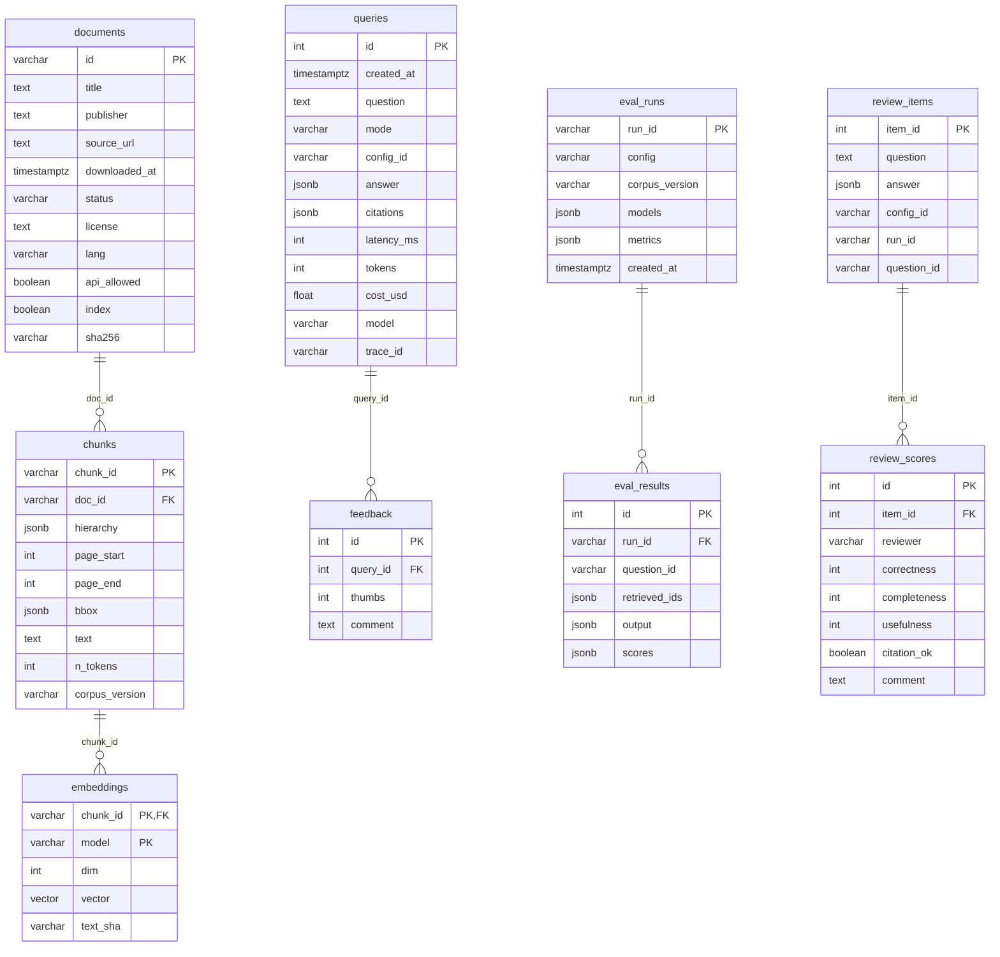

# Diagram relasi database (ERD)

Skema PostgreSQL `k2rag`, diambil dari database yang berjalan (migrasi Alembic). Garis menunjukkan
kunci asing; `PK` kunci utama, `FK` kunci asing. Tabel `alembic_version` (pelacak migrasi) tidak
ditampilkan. Gambar siap pakai untuk laporan: [er-diagram.png](er-diagram.png).

## Penjelasan singkat

| Kelompok | Tabel | Fungsi |
|---|---|---|
| Korpus | `documents` → `chunks` → `embeddings` | Dokumen sumber, potongan pasal (dengan halaman dan kotak sorotan PDF), dan vektor pencarian (satu per chunk per model) |
| Pertanyaan | `queries` → `feedback` | Riwayat tanya jawab beserta biaya dan latensi, dan umpan balik jempol |
| Evaluasi | `eval_runs` → `eval_results` | Satu run per konfigurasi dan split, hasil per pertanyaan |
| Penilaian ahli | `review_items` → `review_scores` | Item jawaban yang disembunyikan konfigurasinya dan skor penilai |

`review_items.run_id` dan `review_items.question_id` merujuk ke hasil evaluasi secara logis, tetapi
tidak dikunci sebagai kunci asing di database.
