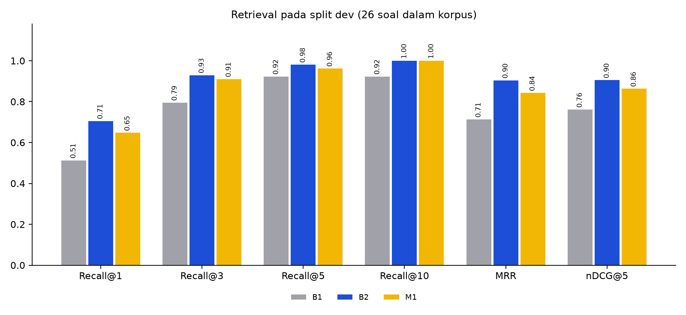
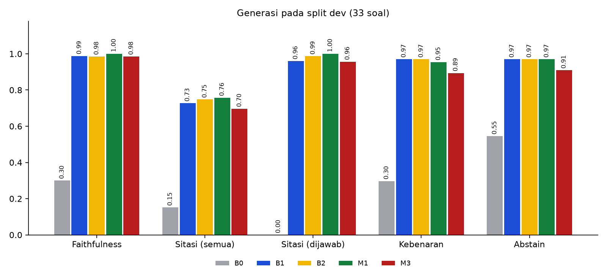
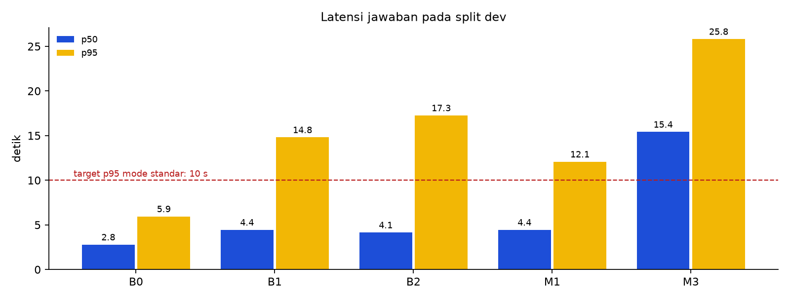

# Hasil evaluasi awal — Minggu 3

Tanggal run: 27 November 2026 · corpus_version `2fa0173fa8be5f95` (126 chunk) · split **dev**.
Angka agregat: [ringkasan_metrik.json](ringkasan_metrik.json). Run mentah ada di `runs/` (tidak di-commit).

## 1. Protokol

| Hal | Keterangan |
|---|---|
| Set uji | 46 pertanyaan dari paket soal tim (`data/eval/sumber_soal_uji.json`), dikonversi oleh `data/eval/build_qa.py` |
| Pembagian | dev 33 (20 faktual, 6 multihop, 7 di luar korpus), test 13. **Test tidak dijalankan** |
| Gold chunk | Diturunkan dari pasal/halaman yang dirujuk tim; **belum diperiksa ulang manusia** ([lembar periksa](../../data/eval/lembar_periksa_gold.md)) |
| Konfigurasi | B0 tanpa retrieval, B1 BM25, B2 dense (bge-m3), M1 hybrid RRF, M3 agentik; top-5; seed 42 |
| Generator | `qwen/qwen3-235b-a22b-2507` via OpenRouter |
| Juri | `openai/gpt-oss-120b` (berbeda dari generator), temperature 0, prompt di `backend/app/eval/prompts` |
| Tuning | Tidak ada perubahan prompt, chunker, atau retrieval berdasarkan hasil ini |

Koreksi selama evaluasi: gold soal A4 semula menunjuk `D2-P1-S1`, padahal definisi PJK2 ada di
`D2-P1-S2`. Gold diperbaiki, lalu retrieval (B1, B2, M1) dan penilaian B0 dijalankan ulang.

## 2. Retrieval (26 soal dalam korpus)

| Konfigurasi | Recall@1 | Recall@3 | Recall@5 | Recall@10 | MRR | nDCG@5 |
|---|---|---|---|---|---|---|
| B1 BM25 | 0,513 | 0,795 | 0,923 | 0,923 | 0,713 | 0,761 |
| **B2 dense** | **0,705** | **0,929** | **0,981** | 1,000 | **0,904** | **0,905** |
| M1 hybrid | 0,647 | 0,910 | 0,962 | 1,000 | 0,842 | 0,863 |

Multihop (6 soal), Recall@5 / MRR: B1 0,667 / 0,583 · B2 0,917 / 0,917 · M1 0,833 / 0,733.



## 3. Generasi (33 soal)

| Konfigurasi | Faithfulness | Sitasi (semua) | Sitasi (dijawab) | Kebenaran | Abstain | p50 (s) | p95 (s) | Token/soal |
|---|---|---|---|---|---|---|---|---|
| B0 | 0,300 | 0,152 | — | 0,297 | 0,545 | 2,8 | 5,9 | 548 |
| B1 | 0,988 | 0,727 | 0,960 | **0,970** | 0,970 | 4,4 | 14,8 | 3.472 |
| B2 | 0,985 | 0,748 | 0,987 | **0,970** | 0,970 | 4,1 | 17,3 | 3.611 |
| M1 | **1,000** | **0,758** | **1,000** | 0,955 | 0,970 | 4,4 | 12,1 | 3.565 |
| M3 | 0,985 | 0,697 | 0,957 | 0,894 | 0,909 | 15,4 | 25,8 | 7.902 |

Cara membaca:

- **Sitasi (semua)** adalah angka resmi harness. Angka itu memberi nilai 0 pada penolakan yang benar
  (tidak ada sitasi untuk dinilai), sehingga 7 soal di luar korpus menurunkan rata-rata.
  **Sitasi (dijawab)** dihitung ulang dari run yang sama, hanya pada soal dalam korpus yang dijawab.
- **B0** tidak punya konteks, jadi faithfulness-nya dinilai terhadap teks gold; tidak setara penuh
  dengan konfigurasi RAG.





### Matriks abstain (26 soal dalam korpus, 7 di luar korpus)

| Konfigurasi | Dalam korpus: dijawab | Dalam korpus: ditolak | Luar korpus: dijawab | Luar korpus: ditolak |
|---|---|---|---|---|
| B0 | 12 | 14 | 1 (OOC5) | 6 |
| B1 | 25 | 1 | 0 | 7 |
| B2 | 25 | 1 | 0 | 7 |
| M1 | 25 | 1 | 0 | 7 |
| M3 | 23 | 3 | 0 | 7 |

## 4. Terhadap target PRD (pada dev)

| Metrik | Target | M1 | Status |
|---|---|---|---|
| Recall@5 | ≥ 0,80 | 0,962 | tercapai |
| MRR | ≥ 0,60 | 0,842 | tercapai |
| Faithfulness | ≥ 0,85 | 1,000 | tercapai |
| Citation correctness | ≥ 0,85 | 0,758 (semua) · 1,000 (dijawab) | belum menurut angka resmi; lihat catatan metrik |
| Abstain benar | ≥ 80% | 97,0% | tercapai |
| Latensi standar p95 | ≤ 10 s | 12,1 s | **belum** |
| M1 mengungguli B0 dan B1 | metrik utama | retrieval: ya · kebenaran: B1 0,970 > M1 0,955 | **sebagian** |
| Skor ahli | ≥ 4,0 / 5 | — | belum dinilai |

## 5. Jawaban sementara atas pertanyaan riset

- **RQ1 (retrieval terbaik).** Pada dev, **dense (B2)** memberi Recall@5 dan MRR tertinggi, di atas
  hybrid (M1) dan BM25 (B1). Selisih B2 dan M1 pada Recall@5 setara kurang dari satu soal, jadi belum
  dapat disimpulkan secara kuat.
- **RQ2 (manfaat RAG + kutipan).** Besar: faithfulness naik dari 0,300 (B0) menjadi 1,000 (M1),
  kebenaran jawaban dari 0,297 menjadi 0,955, dan penolakan yang tepat dari 54,5% menjadi 97,0%.
- **RQ3 (penilaian ahli dan abstain).** Abstain pada soal di luar korpus 7 dari 7 untuk semua
  konfigurasi RAG. Penilaian ahli **belum dilakukan**.

## 6. Analisis kesalahan

| No | Soal | Konfigurasi | Yang terjadi | Kategori | Perbaikan yang diusulkan |
|---|---|---|---|---|---|
| 1 | D2, D4, E1 | M3 | Pasal gold sudah ditemukan (mis. D1-P14, D2-P49), tetapi agen terus mencari sampai batas 6 permintaan lalu menolak (`usage_limit`), latensi 21–28 s | Loop agen | Pada permintaan terakhir paksa agen menyusun jawaban dari bukti yang ada; hentikan pencarian berulang atas kueri serupa |
| 2 | E1 "sertifikat laik fungsi" | B2, M1 | Istilah di soal keliru (yang benar "laik operasi"). Sistem menolak, padahal diharapkan mengoreksi istilah dan menjawab | Generasi: terlalu hati-hati | Instruksi prompt: bila istilah tidak ada tetapi ada istilah yang sangat dekat, koreksi premis dengan sitasi |
| 3 | D1 "setiap instalasi wajib SMK2?" | M1, B2 | Jawaban menyebut batas 200 kVA tetapi melewatkan syarat pemilik berbentuk Badan Usaha (Pasal 26). Pada M1, D2-P26 ada di peringkat 8 sehingga tidak masuk konteks; pada B2 pasalnya ada di konteks tetapi tetap diabaikan | Retrieval (M1) dan generasi (B2) | Naikkan top-k atau tambah pasal terkait; minta model memeriksa semua syarat pada soal premis |
| 4 | C1 pemeliharaan 150 kVA | M1 | Kesimpulan benar tetapi tidak menjelaskan bahwa 150 kVA tidak masuk pengecualian di bawah 100 kVA (Pasal 24), walau pasal itu ada di konteks | Generasi: penalaran multihop tidak lengkap | Minta jawaban menyebut tiap syarat/pengecualian yang diterapkan, dengan sitasi masing-masing |
| 5 | F8 "menurut pedoman" | B2, M1, M3 | Jawaban mencampur Pedoman (D3, dua komponen) dengan Permen D2 Pasal 39 ayat (2) (tiga komponen, termasuk hasil investigasi) | Cakupan sumber | Hormati penyebutan sumber di soal (filter dokumen); tim juga perlu meninjau apakah jawaban acuan harus mencatat komponen ketiga |
| 6 | E2 "SLO" | B1, M1, M3 | Singkatan tidak cocok dengan teks pasal: BM25 tidak menemukan gold di 10 teratas; M1 hanya di peringkat 5 dan 9; M3 mengutip Pedoman, bukan pasal Permen | Retrieval: singkatan/sinonim | Perluasan kueri dengan kamus singkatan (SLO, SKTTK, SBU) yang diambil dari teks regulasi |

Pola utama: kegagalan terbesar bukan pada pencarian pasal, melainkan pada penalaran premis/multihop
dan pada loop agen.

## 7. Latensi, komputasi, dan biaya

- Mesin: laptop AMD Ryzen 9 5980HX, RAM 31 GB. BM25 berjalan lokal; embedding, generator, dan juri
  lewat API OpenRouter, sehingga latensi dipengaruhi jaringan dan penyedia. Pengukuran berurutan
  (satu permintaan pada satu waktu).
- Biaya generator untuk lima konfigurasi sekitar US$0,07; juri sekitar US$0,13 (termasuk penilaian
  ulang B0). Total sekitar **US$0,20**.
- Agentik (M3) memakai sekitar 2,2 kali token M1 dan 3,5 kali latensi median, tanpa peningkatan mutu
  pada set ini.

## 8. Keterbatasan

- Sampel kecil: satu soal setara sekitar 3–4 poin persentase. Selisih antar konfigurasi RAG belum
  dapat dianggap bermakna secara statistik.
- Juri LLM tidak deterministik: menilai ulang jawaban B0 yang **sama** mengubah kebenaran dari 0,318
  menjadi 0,297 (soal di luar korpus 0,786 menjadi 0,714).
- Juri tidak konsisten pada penolakan: penolakan E1 oleh B2 dan M1 dinilai benar, penolakan M3 untuk
  soal yang sama dinilai salah.
- Belum ada tinjauan manusia. Panduan mata kuliah meminta minimal 10 pertanyaan ditinjau manusia.
- Gold chunk belum diverifikasi ulang; dokumen D1 berasal dari OCR yang berderau.
- M2 (reranker) belum dijalankan karena `sentence-transformers` belum dipasang.

## 9. Rencana perbaikan (sebelum evaluasi final)

1. Tim memeriksa lembar gold dan menilai minimal 10 jawaban lewat halaman `/review`.
2. Bekukan split test sebelum ada perubahan apa pun.
3. Perbaiki harness: nilai ketepatan sitasi hanya pada soal yang dijawab (disertai tes).
4. Perbaiki loop agen M3, prompt untuk premis keliru dan multihop, serta perluasan singkatan;
   uji tiap perubahan pada dev.
5. Turunkan latensi p95 mode standar di bawah 10 s (batasi panjang konteks, pilih penyedia model).
6. Jalankan split test satu kali (`--final`) untuk laporan akhir.

## 10. Cara mereproduksi

```
python data/eval/build_qa.py
cd backend
uv run k2 qa-validate
uv run k2 eval --config B1 --split dev        # ulangi untuk B2, M1
uv run k2 eval-gen --config M1 --split dev    # ulangi untuk B0, B1, B2, M3
uv run --with matplotlib python ../data/eval/ringkas_hasil.py
```
